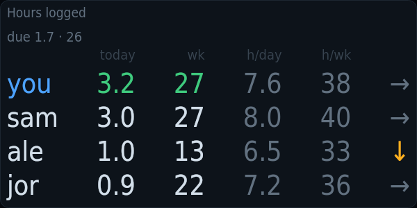
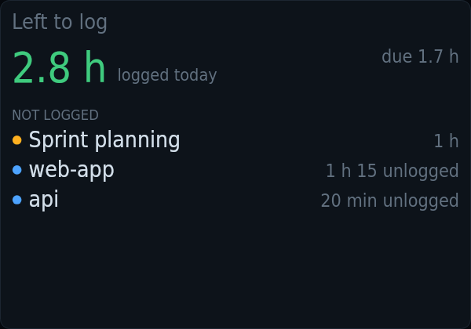

# kiosko-plugin-timesheet

Hours logged in GitLab, yours and your group's, and what is still left to log today.

A plugin for [Kiosko](https://github.com/kiosko-lcd/kiosko), the widget mosaic for small USB LCD panels.



## Install

In Kiosko, **Plugins → Install from npm** → `kiosko-plugin-timesheet`, then restart Kiosko. Or from a terminal:

```sh
npm install --prefix ~/.config/kiosko/plugins kiosko-plugin-timesheet
```

(macOS: `~/Library/Application Support/Kiosko/plugins`, Windows: `%APPDATA%\Kiosko\plugins`.)

## Requirements

- [`glab`](https://gitlab.com/gitlab-org/cli) logged in, or a personal access token with `read_api` in the `timesheet/timelogs` source options.
- For *Left to log*: the `calendar/events` source from [kiosko-plugin-calendar](../kiosko-plugin-calendar) for meetings, and the activity log the aimonitor agent hook writes to `~/.aimonitor/actividad` for agent work.

## Widgets

### Hours logged — `timesheet/hours`

Hours logged in GitLab by you and your group: today, this week, daily and weekly averages, and each one's trend against themselves. Yours turn green or red against what is due by now, per your working week in Settings.


Uses: `timesheet/timelogs`.

| Option | Type | Default | |
|---|---|---|---|
| `rows` | number | `0` | Rows. 0 = as many as fit. A number shows that many, in rows of a readable size (fewer when the tile is too small for them); the rest are counted in "+N more". |
| `columns` | list | `["today","week","dayAvg","weekAvg","trend"]` | Columns. Which figures, in this order. Empty = all. |
| `people` | list | `[]` | People. Empty: the whole group. Usernames or patterns, comma-separated (ana.*, !bot-*); an alias works too. |
| `aliases` | map | `{}` | Names. Username → what to show. Others show their first three letters. |

### Left to log — `timesheet/focus`

What you have logged today against what is due by now (per your working week in Settings), and what is still unlogged: finished meetings and agent activity per project.



Uses: `timesheet/timelogs`, `timesheet/activity`, `calendar/events`.

| Option | Type | Default | |
|---|---|---|---|
| `rows` | number | `0` | Rows. 0 = as many as fit. A number shows that many, in rows of a readable size (fewer when the tile is too small for them); the rest are counted in "+N more". |
| `minPendingMs` | duration (ms) | `900000` | Smallest activity to propose |
| `debtWarnMs` | duration (ms) | `3600000` | Owed: amber from. Hours due by now and not logged yet. |
| `debtAlertMs` | duration (ms) | `7200000` | Owed: red from |
| `meetingGraceMs` | duration (ms) | `900000` | Urgent after a meeting for. 0 = never. |
| `closingMs` | duration (ms) | `1800000` | Urgent before leaving. In the last minutes of the day, if hours are still owed. 0 = never. |

## Data sources

### GitLab timelogs — `timesheet/timelogs`

Hours logged in GitLab by you and your group over the last weeks, and your own entries of today, through glab or a token. Read every 5 min while a widget uses it. Options are set once in Kiosko → Settings → Data sources.

| Option | Type | Default | |
|---|---|---|---|
| `host` | string | `""` | GitLab host. Empty = glab's default host (gitlab.com with a token). |
| `token` | string | *(secret)* | Access token. A personal access token with read_api. Empty = use the glab CLI and its login. |
| `group` | string | `""` | Group. Full path of the GitLab group whose hours to show. Empty = only yours. |
| `me` | string | `""` | Your username. Empty = the logged-in user. |
| `weeks` | number | `4` | Weeks for the averages |
| `bin` | string | `"glab"` | glab command |

### Agent activity — `timesheet/activity`

Today's work blocks per project, from the agent hook's activity log (one JSONL file per day). Read every 2 min while a widget uses it. Options are set once in Kiosko → Settings → Data sources.

| Option | Type | Default | |
|---|---|---|---|
| `dir` | string | `"~/.aimonitor/actividad"` | Activity folder |
| `gapMs` | duration (ms) | `900000` | Gap that splits a block |
| `tailMs` | duration (ms) | `300000` | Time added after the last event |

## Development

```sh
npm install
npm test          # node:test
npm run check     # TypeScript
npm run build     # dist/index.js, what Kiosko loads
```

To try it in a running Kiosko without publishing: `kiosko plugins link .` and restart Kiosko.

Working on Kiosko and its plugins together: clone them side by side
(`kiosko/` and `kiosko-plugins/kiosko-plugin-timesheet/`) and run `npm install` in
`kiosko/`; its workspaces link every plugin found in `../kiosko-plugins`.

## License

MIT
